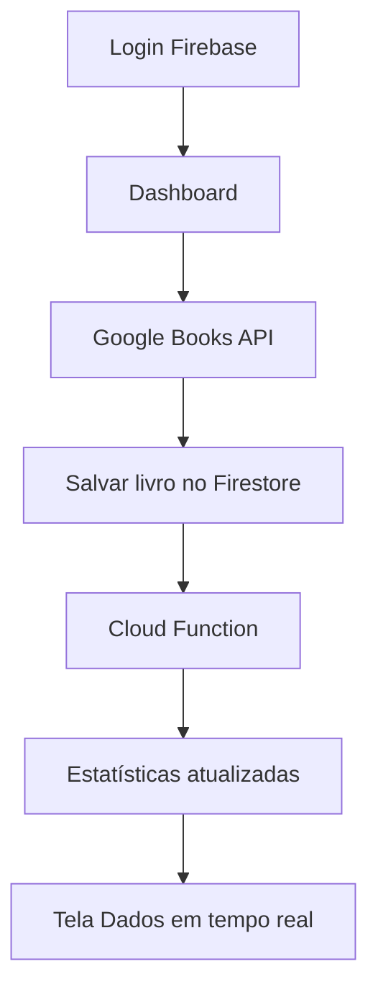

### Book Nook — Estante de Livros Digital
Aplicativo Flutter inspirado no protótipo Warm Literary Nook criado no Stitch. Usa Firebase Authentication, Cloud Firestore, Cloud Functions e Google Books API.
### Funcionalidades
Cadastro e login com e-mail/senha.
Pesquisa por título ou autor na Google Books API.
Estantes Quero Ler, Lendo e Lidos, sincronizadas em tempo real.
Adicionar, mover e remover livros.
Estatísticas de livros e páginas lidas, atualizadas por Cloud Function.
Dashboard, Explorar, Estantes, Dados e Perfil.
Regras do Firestore com acesso isolado por usuário e estatísticas somente leitura no app.
### Pré-requisitos
Flutter SDK, Android SDK, Node.js, Firebase CLI e FlutterFire CLI. O deploy de Cloud Functions exige projeto Firebase no plano Blaze (pode haver cobranças). Não inclua chaves de conta de serviço no repositório.
Instalação
```powershell
flutter create .
flutter pub get
firebase login
flutterfire configure
```
No Firebase Console, ative Authentication > Email/Password e crie um Cloud Firestore. Escolha o mesmo projeto no FlutterFire CLI. O comando gera `lib/firebase_options.dart`, não incluído neste ZIP porque depende da sua conta.
Inicialize o Firebase CLI, caso ainda não tenha feito:
```powershell
firebase use --add
cd functions
npm install
cd ..
firebase deploy --only firestore:rules,functions
flutter run --dart-define-from-file=google_books_secrets.json
```
Antes de executar, substitua `COLE_A_NOVA_CHAVE_AQUI` em `google_books_secrets.json` por uma chave nova da Google Books API. Esse arquivo é ignorado pelo Git. Restrinja a chave no Google Cloud à API necessária; como ela é incluída no aplicativo cliente, não a trate como segredo.
Se `firebase use --add` pedir projeto, selecione o mesmo do FlutterFire. O projeto já inclui `firebase.json` e `functions/package.json`. Confira a versão do Node exigida pelo Firebase antes de implantar.
Dados no Firestore
`users/{uid}/books/{googleBooksId}`: `title`, `author`, `cover`, `pages`, `status`.
`users/{uid}/stats/summary`: `livrosLidos`, `paginasLidas`, `atualizadoEm`.
A Cloud Function `atualizarEstatisticas` reage à criação, atualização e exclusão de livros. Recalcula os totais dos livros atualmente na estante `lido` em uma transação, evitando duplicação por reentrega de eventos. Os números representam o estado atual da estante Lidos, não um histórico vitalício.
Fluxo

### Testes sugeridos
Cadastrar dois usuários e confirmar isolamento das bibliotecas.
Buscar um livro, adicionar em Quero Ler e mover para Lidos.
Conferir se `livrosLidos` e `paginasLidas` mudam.
Mover de volta para Lendo e conferir a redução.
Remover livro Lido e conferir a redução.
Testar API indisponível, sem conexão e senha inválida.
### Observações
A Google Books API pode retornar livros sem `pageCount`, tratados como zero páginas. O layout segue cores creme, marrom e terracota do Stitch, com widgets Flutter nativos; não é uma conversão pixel a pixel do HTML. O projeto não foi executado em um emulador nesta entrega: a configuração do Firebase e os testes finais devem ser feitos localmente.