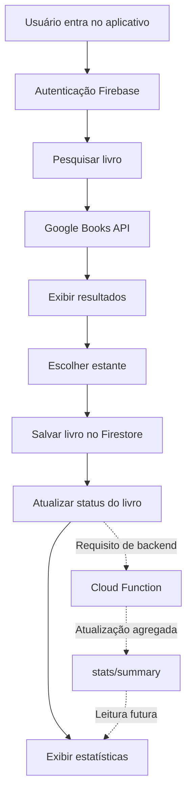

# Book Nook — Estante de Livros Digital

> Projeto acadêmico desenvolvido para a **Situação de Aprendizagem 2 — A Estante de Livros Digital**, com foco em integração de APIs, persistência em nuvem, gerenciamento de estado e automação de backend.

## 1. Visão geral

O **Book Nook** é um aplicativo mobile em **Flutter** para o clube de leitura fictício **Leitores & Cia.**. Seu objetivo é permitir que cada membro descubra livros, organize sua biblioteca pessoal e acompanhe o progresso de leitura.

O aplicativo oferece três estantes virtuais:

- **Quero Ler** (`quero_ler`): livros que o usuário pretende ler.
- **Lendo** (`lendo`): livros em andamento.
- **Lidos** (`lido`): livros concluídos.

A busca utiliza a **Google Books API**. A autenticação e o armazenamento dos livros utilizam serviços do **Firebase**. As estatísticas incluem a quantidade de livros concluídos e a soma de páginas lidas.

**Estado da implementação:** os exemplos e os trechos discutidos durante o desenvolvimento incluem pesquisa de livros, salvamento por status e uma tela de estatísticas que lê os livros diretamente do Firestore. A implantação de uma **Cloud Function** e a consistência de todas as operações em produção **ainda precisam ser verificadas**. A contagem diretamente no Flutter é uma solução provisória e não substitui o requisito de automação no backend.

## 2. Objetivos

### Objetivo geral

Construir um aplicativo de organização de leituras com autenticação individual, pesquisa de livros, estantes virtuais e indicadores de leitura atualizados conforme os dados armazenados.

### Objetivos específicos

1. Integrar uma API REST externa para consulta de livros por título ou autor.
2. Permitir autenticação de membros.
3. Salvar livros e seus status por usuário no Cloud Firestore.
4. Permitir movimentação de livros entre as estantes.
5. Exibir a quantidade de livros lidos e páginas lidas.
6. Implementar e validar uma Cloud Function para atualização automática das estatísticas no backend.
7. Organizar o código em telas, modelos e serviços.

## 3. Tecnologias

| Tecnologia | Finalidade |
|---|---|
| Flutter | Construção da interface mobile |
| Dart | Linguagem do aplicativo |
| Material Design | Componentes visuais e navegação |
| Google Books API | Busca de livros e metadados |
| Firebase Authentication | Cadastro, login e identificação do usuário |
| Cloud Firestore | Persistência de livros, status e estatísticas |
| Firebase Cloud Functions | Automação das estatísticas no backend (requisito a validar) |
| `http` | Requisições HTTP à Google Books API |
| `firebase_core` | Inicialização do Firebase |
| `firebase_auth` | Integração com autenticação |
| `cloud_firestore` | Leitura e escrita no Firestore |

> As versões exatas dos pacotes devem ser consultadas no `pubspec.yaml` do projeto.

## 4. Funcionalidades

### 4.1. Autenticação

O aplicativo foi planejado para oferecer cadastro, login e identificação individual de membros. Os dados de cada usuário devem ficar separados no Firestore por meio do identificador `uid` fornecido pelo Firebase Authentication.

### 4.2. Pesquisa de livros

Na tela **Buscar livros**, o usuário informa um título ou autor. O serviço `GoogleBooksService` realiza uma requisição HTTP à Google Books API e converte os resultados para objetos do modelo `Book`.

Dados apresentados, quando disponíveis:

- Título;
- Autor;
- Capa;
- Número de páginas.

Exemplo de endpoint:

```text
GET https://www.googleapis.com/books/v1/volumes?q=harry+potter&maxResults=20
```

A resposta normalmente contém uma lista `items`, cujos elementos incluem `id` e `volumeInfo`.

### 4.3. Estantes virtuais

O usuário pode adicionar um livro a uma das seguintes categorias:

| Nome na interface | Valor persistido |
|---|---|
| Quero Ler | `quero_ler` |
| Lendo | `lendo` |
| Lidos | `lido` |

**Atenção:** o valor persistido para a estante **Lidos** é `lido` (singular). O aplicativo e a função de backend devem usar o mesmo padrão para evitar divergências.

### 4.4. Estatísticas

A tela **Minhas Estatísticas** apresenta, conforme a implementação discutida:

- Livros lidos;
- Páginas lidas;
- Livros em andamento;
- Livros na lista **Quero Ler**.

Na versão provisória da tela, um `StreamBuilder` acompanha os documentos em `users/{uid}/books`, conta aqueles com `status == 'lido'` e soma o campo de páginas (`pages` ou `pageCount`). Alterações recebidas pelo stream podem atualizar os números automaticamente na interface.

**Limitação importante:** essa abordagem calcula os totais no cliente. O requisito da avaliação pede que os totais sejam mantidos por uma **Cloud Function** em um documento agregado do Firestore. Essa etapa precisa ser implementada ou confirmada no projeto.

## 5. Estrutura do projeto

Estrutura **ilustrativa** baseada nos arquivos discutidos. Outros arquivos e telas podem existir no repositório real.

```text
book_nook/
├── android/
├── lib/
│   ├── main.dart
│   ├── models/
│   │   └── book.dart
│   ├── screens/
│   │   └── home_screen.dart
│   │   └── login_screen.dart
│   │   └── register_screen.dart
│   │   ├── search_screen.dart
│   │   └── stats_screen.dart
│   └── services/
│        └── auth_service.dart
│       ├── book_service.dart
│       └── google_books_service.dart
├── pubspec.yaml
└── README.md
```

### Responsabilidade dos principais arquivos

| Arquivo | Responsabilidade |
|---|---|
| `main.dart` | Inicialização e entrada do aplicativo |
| `models/book.dart` | Representação dos livros e conversão da resposta da API |
| `screens/search_screen.dart` | Formulário de pesquisa, resultados e ação de salvar nas estantes |
| `screens/stats_screen.dart` | Exibição dos indicadores de leitura |
| `services/google_books_service.dart` | Comunicação HTTP com a Google Books API |
| `services/book_service.dart` | Persistência e consulta de livros/estatísticas no Firestore |

## 6. Pré-requisitos

- Flutter SDK e Dart instalados;
- Android Studio ou VS Code com suporte a Flutter;
- Emulador Android ou dispositivo físico;
- Projeto Firebase configurado para o aplicativo;
- Google Books API ativada em um projeto Google Cloud;
- Chave de API válida e com cota disponível;
- Acesso à internet.

Confira o ambiente:

```bash
flutter doctor
```

## 7. Instalação e execução

### 7.1. Abrir o projeto

No terminal, acesse a pasta do aplicativo:

```powershell
cd C:\Users\2DevSesi\mobile\firebase\book_nook
```

### 7.2. Instalar dependências

```bash
flutter pub get
```

Se os pacotes ainda não estiverem declarados no `pubspec.yaml`, adicione os necessários:

```bash
flutter pub add http firebase_core firebase_auth cloud_firestore
```

### 7.3. Configurar o Firebase

1. Crie ou selecione um projeto no [Firebase Console](https://console.firebase.google.com/).
2. Registre o aplicativo Android com o identificador de pacote correto.
3. Configure o Firebase para Flutter conforme a documentação oficial.
4. Ative o método de login utilizado pelo projeto em **Authentication**.
5. Crie o banco em **Firestore Database**.
6. Confirme que a inicialização do Firebase está presente no `main.dart`.

Documentação: [Firebase para Flutter](https://firebase.google.com/docs/flutter/setup).

### 7.4. Configurar a Google Books API

1. Acesse o [Google Cloud Console](https://console.cloud.google.com/).
2. Selecione o projeto que será responsável pela API.
3. Em **APIs e serviços → Biblioteca**, ative **Books API**.
4. Em **Credenciais**, crie uma chave de API.
5. Restrinja a chave à Books API e configure as restrições de uso apropriadas.
6. Verifique as cotas disponíveis.

O serviço Flutter foi preparado para ler a variável de compilação:

```dart
static const String apiKey = String.fromEnvironment(
  'GOOGLE_BOOKS_API_KEY',
);
```

Para executar localmente:

```powershell
flutter run --dart-define="GOOGLE_BOOKS_API_KEY=SUA_CHAVE_AQUI"
```

Substitua `SUA_CHAVE_AQUI` por uma chave válida **somente no seu ambiente**. Não publique a chave no README nem em commits. Uma chave incorporada a um aplicativo cliente pode ser extraída; para produção, considere um backend intermediário e restrições adequadas.

**Segurança:** uma chave compartilhada anteriormente em conversas, imagens ou repositórios deve ser revogada e substituída.

### 7.5. Permissão de internet no Android

No arquivo `android/app/src/main/AndroidManifest.xml`, confirme a presença da permissão antes de `<application>`:

```xml
<uses-permission android:name="android.permission.INTERNET" />
```

Depois de modificar configurações nativas, execute novamente o aplicativo (não dependa apenas de hot reload).

## 8. Organização dos dados no Firestore

Estrutura **esperada**, a ser conferida com `book_service.dart` e as regras reais do projeto:

```text
users/
  {userId}/
    books/
      {bookId}/
        id: "..."
        title: "..."
        author: "..."
        cover: "..."
        pages: 250
        status: "lido"
    stats/
      summary/
        livrosLidos: 1
        paginasLidas: 250
```

O exemplo acima demonstra a organização dos dados, não comprova que o documento `stats/summary` já esteja sendo criado pelo aplicativo.

### Regras de consistência

- Cada livro deve ter identificador estável para evitar duplicações.
- Os status devem ser padronizados: `quero_ler`, `lendo`, `lido`.
- O número de páginas deve ser tratado como inteiro não negativo.
- Cada usuário deve acessar apenas seus próprios registros.
- A interface não deve escrever diretamente os contadores agregados quando a Cloud Function for a fonte oficial.

## 9. Fluxo de funcionamento



**Legenda:** as conexões tracejadas representam a automação de backend prevista no escopo, cuja implantação precisa ser validada.

## 10. Cloud Function — requisito principal da avaliação

A avaliação exige uma função acionada quando o status de um livro for alterado para **Lido**. A implementação deve manter os indicadores em `users/{userId}/stats/summary`.

### Comportamento esperado

1. Detectar alteração de um documento de livro.
2. Comparar o status anterior e o novo status.
3. Ao entrar em `lido`, incrementar `livrosLidos` e adicionar as páginas.
4. Ao sair de `lido`, reverter os valores correspondentes, se a regra de negócio exigir estatísticas do estado atual.
5. Evitar contagens duplicadas em atualizações repetidas ou reprocessamento de eventos.
6. Tratar alterações no número de páginas de livros já concluídos.
7. Usar operações transacionais/idempotentes para preservar a consistência.
8. Proteger os documentos de estatísticas contra alterações indevidas pelo cliente.

**Observação técnica:** um gatilho `onUpdate` trata alterações em documentos existentes, mas **não** cobre a criação inicial de um livro já marcado como `lido`. Se o aplicativo permite adicionar diretamente à estante **Lidos**, também é necessário tratar a criação (`onCreate`) ou utilizar um gatilho de escrita apropriado (`onWrite`/`onDocumentWritten`, conforme a versão do SDK).

A implementação da função e o respectivo deploy **não foram fornecidos para revisão nesta documentação**. Portanto, não devem ser apresentados como concluídos sem testes.

Documentação: [Cloud Firestore triggers](https://firebase.google.com/docs/functions/firestore-events).

## 11. Gerenciamento de estado

O aplicativo utiliza streams para refletir alterações do Firestore na interface.

Na tela de estatísticas provisória, o fluxo é:

```text
Firestore (books)
       ↓
.snapshots()
       ↓
StreamBuilder
       ↓
Contagem por status
       ↓
Cards de estatísticas
```

Após a implementação definitiva da Cloud Function, a tela deverá observar o documento `stats/summary` e exibir os valores calculados no backend.

## 12. Tratamento de erros

| Situação | Comportamento esperado |
|---|---|
| Campo de busca vazio | Não enviar requisição |
| Sem internet | Exibir mensagem amigável |
| Timeout | Informar demora e permitir nova tentativa |
| HTTP 403 | Orientar a conferir chave, permissões e restrições |
| HTTP 429 | Informar que o limite de consultas foi atingido |
| Livro sem capa | Exibir ícone substituto |
| Livro com dados incompletos | Tratar ou ignorar item inválido |
| Falha ao salvar no Firestore | Informar que o livro não foi salvo |
| Usuário não autenticado | Solicitar login |
| Erro ao ler estatísticas | Exibir mensagem de erro |

**Importante:** um erro `429` de cota não pode ser corrigido apenas alterando a interface Flutter. É necessário verificar a cota e a configuração da API no Google Cloud.

## 13. Segurança

- Utilizar Firebase Authentication para identificar cada usuário.
- Aplicar regras do Firestore para impedir leitura e escrita entre contas.
- Não confiar apenas em validações no aplicativo.
- Não expor chaves ou credenciais em código público.
- Não exibir tokens, chaves ou respostas sensíveis em mensagens de erro.
- Proteger os agregados de estatísticas contra escrita direta pelo cliente.
- Validar status e campos numéricos no backend.

As regras reais do Firestore precisam ser verificadas antes da entrega.

## 14. Testes recomendados

| Teste | Resultado esperado |
|---|---|
| Cadastrar e entrar | Usuário autenticado |
| Pesquisar por título | Lista de livros correspondente |
| Pesquisar por autor | Lista de livros correspondente |
| Pesquisar texto vazio | Nenhuma requisição |
| Adicionar a Quero Ler | Livro salvo com `quero_ler` |
| Adicionar a Lendo | Livro salvo com `lendo` |
| Adicionar a Lidos | Livro salvo com `lido` |
| Alterar de Lendo para Lidos | Livro passa a contar como concluído |
| Alterar de Lidos para Lendo | Totais são ajustados conforme regra de negócio |
| Repetir alteração sem mudar status | Sem contagem duplicada |
| Livro sem páginas informadas | Aplicativo continua funcionando |
| Abrir estatísticas em outra sessão | Dados coerentes com o Firestore |
| Desconectar a internet | Mensagem amigável |
| API retornar 429 | Mensagem de limite excedido |

Esses são **casos de teste planejados**, não resultados de uma execução automatizada.

## 15. Critérios da avaliação

| Critério | Como demonstrar | Situação a confirmar |
|---|---|---|
| Integração com Google Books API | Busca por título/autor | Chave e cota válidas |
| Autenticação | Login individual | Fluxo completo de cadastro/login |
| Gerenciamento de estantes | Salvar e mudar status | Persistência e atualização no Firestore |
| Exibição de estatísticas | Contadores na interface | Valores corretos |
| Cloud Function | Atualização automática de agregados | **Implementação e deploy pendentes de validação** |
| Qualidade do backend | Código legível, seguro e testado | Revisão das funções e regras |

## 16. Melhorias futuras

- Implantar e validar a Cloud Function definitiva;
- Adicionar testes automatizados para transições de status;
- Criar indicadores de leitura por mês;
- Adicionar filtros e ordenação de livros;
- Melhorar cache e tratamento de limites da API;
- Incluir edição de perfil e personalização de estantes;
- Ampliar acessibilidade e adaptação para diferentes telas.

## 17. Referências

- [Flutter — documentação oficial](https://docs.flutter.dev/)
- [Dart — documentação oficial](https://dart.dev/guides)
- [Google Books API](https://developers.google.com/books/docs/v1/using)
- [Firebase para Flutter](https://firebase.google.com/docs/flutter/setup)
- [Firebase Authentication](https://firebase.google.com/docs/auth)
- [Cloud Firestore](https://firebase.google.com/docs/firestore)
- [Cloud Functions para Firebase](https://firebase.google.com/docs/functions)
- [Gatilhos do Firestore](https://firebase.google.com/docs/functions/firestore-events)

---

**Projeto:** Book Nook — Estante de Livros Digital  
**Cliente fictício:** Clube do Livro Leitores & Cia.  
**Atividade:** Situação de Aprendizagem 2  
**Plataforma:** Flutter / Android  
**Foco:** Backend, Firestore, Cloud Functions e gerenciamento de estado  
**Documentação atualizada:** outubro de 2026
